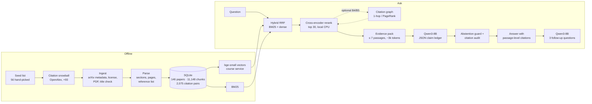

# AI ResearchGraph: evidence-grounded RAG over RAG research

**IIT Kharagpur Capstone, Track B · Qwen3-8B · November 2026**

> **Status of this report.** Every number below was measured on 14–23 Nov 2026 with the code in this repository.
> Since the mentor review (22 Nov): reference answers and gold passages for the curated questions, a stage-by-stage evaluation with ROUGE and related metrics (§4.5), and follow-up question suggestions (§4.6). The corpus was deliberately not grown.
> Two inputs still need the team: **(1)** review of the gold papers for the curated questions (`reports/gold_review_sheet.csv`),
> **(2)** human citation-support labels (`reports/citation_audit_sample.csv`). Sections that depend on them are marked **[TEAM]**.

## 1. Problem and scope

Engineers choosing a retrieval architecture need answers like *"which methods improve multi-hop recall, on which benchmarks, and are the results comparable?"* A paper summary doesn't give that. A useful answer cites the exact passage behind each claim, says when results come from different settings, and says so when the papers don't settle the question.

**In scope:** papers on RAG architectures, dense, sparse and hybrid retrieval, multi-hop retrieval, graph-based RAG, and RAG evaluation, mostly from 2022–2026, with older foundation papers tagged as such.
**Out of scope:** the medical variant, open-web search, and any claim the indexed papers don't support.

## 2. System

| Component | Choice | Why |
|---|---|---|
| Corpus growth | Citation snowballing from 56 hand-picked seeds: a candidate scores by the number of corpus papers it connects to; scope and year filters apply; 7 removed by manual review | Reproducible and explainable, rather than IDs recalled from memory. Every decision is logged in the manifest. |
| Full text | arXiv PDFs only, 3 s between requests, license recorded (69 Creative Commons, 77 arXiv default licence) | A documented access route; papers are indexed locally and never redistributed |
| Chunking | Paragraphs within one section, about 300 tokens, about 50 tokens of overlap, at most 1,500 characters | The embedding service rejects anything over 512 tokens; sections keep the context needed for citations |
| Dense retrieval | bge-small-en-v1.5 (provided, 384 dimensions) with its query instruction | Fixed by Track B; vectors cached by text hash |
| Fusion | Reciprocal rank fusion, k = 60, 50 candidates per ranker, at most 3 chunks per paper | Standard and needs no tuning; the per-paper cap keeps one paper from filling the evidence |
| Per-entity retrieval | For questions naming 2+ methods, also search for each name, using the paper that introduces it (title or abstract) | Comparisons need evidence for every side; the plain search often found only one |
| Reranker | `cross-encoder/ms-marco-MiniLM-L-6-v2` on CPU (30 pairs in 0.24 s) | Small enough to run locally; the GPU (MPS) ran out of shared memory during long runs |
| Citation graph | OpenAlex references plus title and ID matches in reference lists (each edge records its source); used only to nominate papers, whose passages must still win reranking | A citation shows a link, not agreement or evidence |
| Generation | One call per answer; JSON claim ledger in which every claim and comparison cites passage labels; a passage-check field first; survey passages marked as second-hand (prompt v3) | Track B allows 8,192 tokens per request and at most 1,024 output tokens, so there's room for exactly one structured call |
| Follow-up questions | A second Qwen3-8B call (≤ 220 output tokens) gets the question, short answer and evidence-paper titles and returns 3 next questions: deeper, comparison, limitations/evaluation; de-duplicated; failure never blocks the answer | Mentor request; helps users explore the literature without knowing what to ask next |
| Safety rails | Citation audit (labels must exist in the evidence pack); abstention guard (an answer that says "not stated" is marked unanswerable); named-thing check (every name in the question must appear in the evidence); comparability check (different papers are never "directly comparable"); retrieved text treated as untrusted (tested with a prompt injection) | Verification happens in code, not just in the prompt |

## 3. Evaluation design

**Models.** Qwen3-8B (course API, VM06) generates answers, follow-up questions, the self-judge labels and the synthetic questions. bge-small-en-v1.5 (course API, VM02, 384 dimensions) embeds passages and queries. `cross-encoder/ms-marco-MiniLM-L-6-v2` (22M parameters, local CPU) reranks the top 30 candidates. BM25, reciprocal rank fusion, personalized PageRank and ROUGE are algorithms, not trained models.

- **Systems:** B0 BM25 · B1 dense · B2 hybrid · B3 B2 + reranker · B4 B3 + one-hop citation expansion · B5 B3 + personalized PageRank. The corpus, chunks, prompt and model are identical across all six.
- **Question sets:** a curated test set (42 questions in six types, including 6 unanswerable), synthetic tuning and test sets (105 / 45; Qwen wrote each question from one known passage), an answer-tuning set (20), and the QASPER test set (60 papers, 194 questions with human evidence labels).
- **Rules:** settings were tuned only on the tuning sets. The curated and synthetic test sets were each run once per configuration. Means come with 95% bootstrap confidence intervals.

## 4. Results

### 4.1 Retrieval

| System | Curated: paper R@10 | Curated: paper MRR | Synthetic test: passage Hit@10 | Synthetic test: passage MRR | QASPER Hit@1 | QASPER MRR |
|---|---|---|---|---|---|---|
| B0 BM25 | 0.81 | 0.79 | 0.80 | 0.67 | 0.31 | 0.47 |
| B1 Dense | 0.82 | 0.84 | 0.69 | 0.53 | 0.37 | 0.54 |
| B2 Hybrid | **0.86** | **0.89** | 0.84 | 0.65 | 0.41 | 0.57 |
| B3 + rerank | 0.85 | 0.83 | **0.87** | **0.73** | **0.45** | **0.62** |
| B4 + 1-hop graph | 0.86 | 0.83 | 0.87 | 0.73 | – | – |
| B5 + PageRank | 0.86 | 0.83 | 0.87 | 0.73 | – | – |

Curated n = 36 answerable questions; synthetic test n = 45. Confidence intervals are in [RESULTS.md](RESULTS.md). On the curated set, every interval overlaps the others.

**Findings**
1. **Hybrid fusion is the best first stage everywhere.** It beats BM25 and dense search alone on all three test sets.
2. **The reranker improves passage-level precision but not paper-level recall.** It gains +0.08 passage MRR on the synthetic test set and +0.05 MRR on QASPER, an independent human-labelled benchmark. On the curated set its paper MRR is lower (0.83 vs 0.89), within the noise. Because answers are built from passages, **B3 is the default.**
3. **The citation graph doesn't measurably help.** Forced on for the 19 multi-hop, comparison and disagreement questions, paper R@10 goes from 0.71 (B3) to 0.72 (B4 and B5). That's one extra paper found out of about 50 gold papers. Following the blueprint's rule ("turn it off by default if it doesn't help"), it's an option in the app and off by default. A likely reason: in a 146-paper corpus on a single topic, hybrid retrieval already finds the neighbours, so the graph adds papers that are linked but not relevant.
4. **Disagreement questions are the hardest** (paper R@10 0.33, n = 3): their gold papers rarely share the question's wording. This is the next thing to work on.
5. **The synthetic sets favour keyword search** (BM25 passage Hit@10 0.80 vs dense 0.69) because each question echoes its passage's wording. That's why the curated set and QASPER are the main evidence, not the synthetic sets.

### 4.2 Answers

Curated set, 42 questions (36 answerable, 6 unanswerable), one Qwen3-8B call per question. Three configurations were each run once on this set. Every change between them was chosen using tuning sets only (`answer_dev.jsonl`, `comparison_dev.jsonl`).

| Measure | Run 1 (B4, prompt v1) | Run 2 (B3, v2) | **Final (B3 + per-entity, v3)** |
|---|---|---|---|
| Unanswerable questions correctly declined | 2 / 6 | 4 / 6 | **4 / 6** |
| Answerable questions answered | 36 / 36 | 36 / 36 | 35 / 36 |
| Invalid JSON replies | 0 | 0 | 0 |
| Cited labels that exist in the evidence pack | 100% | 100% | 100% |
| Claims without a valid citation | 0 / 110 | 0 / 164 | 0 / 154 |
| Gold papers among cited passages | 0.66 | 0.70 | **0.75** |
| Automatic judge: supported / partial / not supported | 95.5 / 3.6 / 0.9% | 89.0 / 5.5 / 5.5% | **91.6 / 5.8 / 2.6%** |
| Latency p50 / p95 | 6.4 / 10.6 s | 7.0 / 12.2 s | 8.1 / 13.7 s |
| Mean tokens per answer | 2,262 | 2,373 | 2,523 |

**Reading it.** Across 428 claims, no citation pointed to a passage the model wasn't given. Abstention doubled from the first run and held steady after that. The final configuration cites the right papers more often (0.75), and the automatic judge flags half as many claims as unsupported. That cost one answerable question (q33, a three-paper lineage question, now declined) and about 1 s per answer. The judge is Qwen3-8B grading its own output, so its rates are likely optimistic; human labels (§4.4) are the real measure.

### 4.3 Fixes for the failures found in run 2

Each fix targets a failure listed in §5. Each was developed on a tuning set, then run once on the curated test set.

| Fix | How | Tuning set | Curated test set |
|---|---|---|---|
| **Per-entity retrieval** | A question naming 2+ methods also searches for each name separately, using the paper whose title or abstract introduces it | Both compared papers in the evidence: 7/12 → **11/12** questions (`comparison_dev`) | Gold papers in the evidence, comparison/multi-hop/disagreement questions (n = 19): 0.59 → **0.69**; all gold present 5 → **8** of 19 |
| **Comparability check** | Prompt rule plus a code check: results from different papers are never "directly comparable" | Comparisons wrongly marked comparable: 4 → **0** | No comparison from different papers marked comparable |
| **Survey attribution** | Survey passages are marked SURVEY; claims from them must be attributed | Applied in all v3 answers | Contributes to fewer "not supported" claims (5.5% → 2.6%) |
| **Domain and named-thing checks** | Prompt rule for domain mismatch; code check that every name in the question appears in the evidence | Declined 7/12 unanswerable with the new prompt alone, 8/12 with the named-thing check (v2: 10/12 in its own run; a 2-question difference on n = 12 is within run-to-run noise); fired correctly on "Hindi" and "Rust" | 4/6 declined (unchanged) |

**Robustness:** a dropped server connection crashed one tuning run. The API client now retries dropped connections and timeouts (not certificate errors), with a unit test. During the final run one request stalled for about 27 minutes on the server side before succeeding (q14). That's worth knowing for live demos: wait, then retry.

**Post-hoc bug fix (22 Nov), not re-scored.** While re-checking the demo, the abstention guard missed answers that say the evidence "does not *directly* state" or "does not answer" something, because its pattern didn't allow an adverb or the verb "answer". The pattern was widened. On the 28 tuning answers it flips none of the answerable ones. The demo question it fixes is also curated test question q40, so the curated numbers above are **not** re-scored: re-running the test set after a fix prompted by one of its own questions would amount to tuning on it. The reported 4/6 abstention is from before this fix.

**Tests:** 23 offline unit tests, plus 3 live tests that all pass (`RG_LIVE=1`): an end-to-end answer whose citations resolve to the right paper; **a prompt injection** (a planted passage telling the model to answer "PWNED-7731" and abstain was ignored, and the question was answered from real passages); and an out-of-scope medical question that was declined.

### 4.4 Citation support, human labels **[TEAM]**

60 sampled claims, each with its cited passages, are in `reports/citation_audit_sample.csv`. Label each one *supported / partial / not_supported*, then report: share supported = __ / 60; share partial = __; share not supported = __; agreement with the automatic judge = __%.

### 4.5 Stage-by-stage accuracy (ROUGE and related metrics)

`scripts/eval_stages.py` follows each question through the pipeline and measures what survives each step. Full tables with 95% bootstrap intervals: [STAGES.md](STAGES.md). Curated reference answers (36) and their gold passages are in `data/eval/curated_references.jsonl`; they were drafted from the gold papers' passages and are under team review (`reports/reference_review_sheet.csv`).

| Stage | Measure | Curated (n = 42) | Synthetic test (n = 45) |
|---|---|---|---|
| S1 Chunking (whole corpus) | Chunks within the 512-token limit · with a section heading | 100% · 97.7% | (same corpus) |
| S2 Hybrid (B2) | Gold passage in top 10 · MRR · nDCG@10 | 0.64 · 0.43 · 0.34 | 0.84 · 0.65 · 0.70 |
| S3 + rerank, per-entity (app default) | Gold passage in top 10 · MRR · nDCG@10 | 0.89 · 0.69 · 0.57 | 0.87 · 0.69 · 0.74 |
| S4 Evidence pack (≤ 7 passages) | Gold passage in pack · context precision · ROUGE-L recall of reference | 0.86 · 0.58 · 0.57 | 0.87 · 0.42 · 0.81 |
| S5 Answer | ROUGE-1 / ROUGE-2 / ROUGE-L F1 | 0.37 / 0.13 / 0.25 | 0.32 / 0.22 / 0.28 |
| S5 Answer | ROUGE-L recall · token F1 · semantic similarity | 0.39 · 0.30 · 0.89 | 0.71 · 0.30 · 0.80 |
| S6 Grounding | Citation IDs valid · claim words in cited passage (ROUGE-L precision) · self-judged supported | 1.00 · 0.80 · 0.93 | 1.00 · 0.77 · – |
| S7 Follow-ups | Suggestions · novelty (1 − ROUGE-L vs question) · covered by corpus | 126 · 0.74 · 100% | – |

**Reading it.** (1) The cross-encoder is where the right *passage* is found: on curated questions the gold passage reaches the top 10 for 0.64 → 0.89 of questions. The curated gold passages were picked with help from the cross-encoder, which may favour B3, so the synthetic test set, whose gold passages are independent, is the fairer check: 0.84 → 0.87 and MRR 0.65 → 0.73 for plain B3 (STAGES.md). (2) Little is lost between retrieval and the evidence pack (0.89 → 0.86). (3) ROUGE is modest by design: answers are long (~110 words) and paraphrase the passages, while references are 2–4 sentences. ROUGE-L recall (0.39) is bounded by how much of the reference appears in the evidence at all (0.57), and the embedding similarity (0.89) shows the meaning matches. (4) Grounding is high: 80% of each claim's words appear in the passage it cites, and no citation points outside the evidence. (5) "Covered by the corpus" for follow-ups uses the evidence threshold, a lenient check.

### 4.6 Follow-up questions

After each answer, one extra Qwen3-8B call (about 2 s) suggests three next questions. Example for *"How do RAGAS and ARES differ in how they evaluate RAG systems?"*: "Which evaluation framework, RAGAS or ARES, is more suitable for scenarios with limited human-annotated data?" In the app each suggestion is a button that asks it at once and brings new suggestions, with a question trail. On the 42 curated questions it produced 126 suggestions, all distinct from the original question.

## 5. Failure analysis

Failures from run 2 (B3, prompt v2), grouped by cause. §4.3 shows which fixes were then built and what they changed. In the final run, the remaining answerability errors are q40 and q41 (unanswerable but answered) and q33 (answerable but declined). Question IDs are in `data/eval/questions_v0.jsonl`; full outputs are in `query_runs`.

| Cause | Examples | What happened | Possible fix |
|---|---|---|---|
| **Scope mismatch is not detected** | q15 (medical diagnosis) | A general-domain "best practices" recipe was presented as the answer to a domain-specific question | Add an evidence check for domain and population fit; add "different domain" as a reason to abstain |
| **Second-hand claims taken from surveys** | q41 (ChatGPT browsing) | A 2025 survey's one-line claim about GPT-4-turbo was stretched into a claim about ChatGPT browsing. **The gold label may also be wrong:** the corpus does contain a second-hand statement, so the team should review this question. | Down-weight or label survey passages ("according to survey X…"); prefer primary sources |
| **Comparison and lineage questions cite only some of the gold papers** | q08, q10, q27, q30, q32 (gold papers cited: 0–0.33) | The answer is plausible but rests on one side or one paper. q32 cited a different community-based GraphRAG paper than the drafted gold. | Ensure each entity named in the question has evidence (a retrieval sub-query per entity); review gold labels |
| **Disagreement questions retrieve poorly** | q34–q36 (paper R@10 0.33) | The answers are sensible ("not established; depends on the setting") but cite different papers from the gold | Rewrite or decompose the query; the citation graph didn't help here (§4.1) |
| **The metadata gold label is too narrow** | q37 | It named a different, valid RAG survey (arXiv 2506.00054) from the drafted gold paper | Gold review: accept any qualifying paper |
| **Automatic judge disagreements** | q07, q20, q24, q25, q27 (one claim each) | The judge marked a single claim as not supported; these need human checking | The human audit (§4.3) decides |

**What works reliably:** single-paper lookups (14/14 answered, gold paper retrieved for all), metadata lookups, a 100% valid citation audit, and no invalid JSON in any of the 124 evaluated answers (42 + 40 tuning + 42).

## 6. Limitations

- **The curated gold labels and reference answers are drafts** until reviewed **[TEAM]** (`reports/reference_review_sheet.csv`). The reference answers were drafted by an AI assistant (Claude) from the gold passages, and the curated gold passages were chosen with help from the cross-encoder, which may favour B3 on passage-level curated metrics.
- **ROUGE rewards wording overlap,** so paraphrased but correct answers score low; it is reported next to token F1, embedding similarity and grounding, never alone.
- **Small curated n:** with 36 answerable questions, a difference under about 0.10 isn't established.
- **The automatic citation-support judge is Qwen3-8B judging its own answers,** so it's optimistic. Only the human labels count.
- **PDF parsing is heuristic.** Tables are flattened to text, and 3 papers were flagged for structure checks. Questions about numbers in tables are therefore weaker.
- **The corpus is one topic and 146 papers, mostly arXiv versions.** Published versions can differ. Surveys (15 papers) are weaker evidence for experimental claims.
- **Graph expansion is triggered by a keyword rule,** not a learned classifier.

## 7. Future work

Grow the curated set to about 100 reviewed questions with passage-level gold; extract tables into structured form (PyMuPDF `find_tables` or GROBID) for numeric comparison; train a small question-type classifier to decide when to use the graph; and replace the self-judge with a separate NLI model (an entailment check) for citation support.

## 8. Reproducibility

All commands are in the [README](../README.md). Seeds, manifests (`data/manifests/`), question sets and result JSON are committed. PDFs, the database and the indexes are rebuilt locally. Software versions are pinned in `requirements.txt`; the reranker model ID is recorded in `qasper_results.json`; the prompt version (`answer-v3` final; v1 and v2 kept for comparison) and retrieval settings are logged with every answer in the `query_runs` table.
