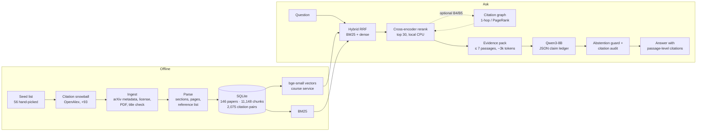

# AI ResearchGraph: evidence-grounded RAG over RAG research

**IIT Kharagpur Capstone, Track B · Qwen3-8B · November 2026**

> **Status of this report.** Every number below was measured on 14–19 Nov 2026 with the code in this repository.
> Two inputs still need the team: **(1)** review of the gold papers for the curated questions (`reports/gold_review_sheet.csv`),
> **(2)** human citation-support labels (`reports/citation_audit_sample.csv`). Sections that depend on them are marked **[TEAM]**.

## 1. Problem and scope

Engineers choosing a retrieval architecture need answers like *"which methods improve multi-hop recall, on which benchmarks, and are the results comparable?"* A paper summary doesn't give that. A useful answer cites the exact passage behind each claim, says when results come from different settings, and says so when the papers don't settle the question.

**In scope:** papers on RAG architectures, dense, sparse and hybrid retrieval, multi-hop retrieval, graph-based RAG, and RAG evaluation, mostly from 2022–2026, with older foundation papers tagged as such.
**Out of scope:** the medical variant, open-web search, and any claim the indexed papers don't support.

## 2. System

| Component | Choice | Why |
|---|---|---|
| Corpus growth | Citation snowballing from 56 hand-picked seeds: a candidate scores by the number of corpus papers it connects to; scope and year filters apply; 7 removed by manual review | Reproducible and explainable, rather than IDs recalled from memory. Every decision is logged in the manifest. |
| Full text | arXiv PDFs only, 3 s between requests, license recorded (69 Creative Commons, 77 arXiv default licence) | A documented access route; papers are indexed locally and never redistributed |
| Chunking | Paragraphs within one section, about 300 tokens, about 50 tokens of overlap, at most 1,500 characters | The embedding service rejects anything over 512 tokens; sections keep the context needed for citations |
| Dense retrieval | bge-small-en-v1.5 (provided, 384 dimensions) with its query instruction | Fixed by Track B; vectors cached by text hash |
| Fusion | Reciprocal rank fusion, k = 60, 50 candidates per ranker, at most 3 chunks per paper | Standard and needs no tuning; the per-paper cap keeps one paper from filling the evidence |
| Reranker | `cross-encoder/ms-marco-MiniLM-L-6-v2` on CPU (30 pairs in 0.24 s) | Small enough to run locally; the GPU (MPS) ran out of shared memory during long runs |
| Citation graph | OpenAlex references plus title and ID matches in reference lists (each edge records its source); used only to nominate papers, whose passages must still win reranking | A citation shows a link, not agreement or evidence |
| Generation | One call per answer; JSON claim ledger in which every claim cites passage labels; a passage-check field first (prompt v2) | Track B allows 8,192 tokens per request and at most 1,024 output tokens, so there's room for exactly one structured call |
| Safety rails | Citation audit (labels must exist in the evidence pack), abstention guard (if the answer says "not stated", the question is marked unanswerable), retrieved text treated as untrusted | Verification happens in code, not just in the prompt |

## 3. Evaluation design

- **Systems:** B0 BM25 · B1 dense · B2 hybrid · B3 B2 + reranker · B4 B3 + one-hop citation expansion · B5 B3 + personalized PageRank. The corpus, chunks, prompt and model are identical across all six.
- **Question sets:** a curated test set (42 questions in six types, including 6 unanswerable), synthetic tuning and test sets (105 / 45; Qwen wrote each question from one known passage), an answer-tuning set (20), and the QASPER test set (60 papers, 194 questions with human evidence labels).
- **Rules:** settings were tuned only on the tuning sets. The curated and synthetic test sets were each run once per configuration. Means come with 95% bootstrap confidence intervals.

## 4. Results

### 4.1 Retrieval

| System | Curated: paper R@10 | Curated: paper MRR | Synthetic test: passage Hit@10 | Synthetic test: passage MRR | QASPER Hit@1 | QASPER MRR |
|---|---|---|---|---|---|---|
| B0 BM25 | 0.81 | 0.79 | 0.80 | 0.67 | 0.31 | 0.47 |
| B1 Dense | 0.82 | 0.84 | 0.69 | 0.53 | 0.37 | 0.54 |
| B2 Hybrid | **0.86** | **0.89** | 0.84 | 0.65 | 0.41 | 0.57 |
| B3 + rerank | 0.85 | 0.83 | **0.87** | **0.73** | **0.45** | **0.62** |
| B4 + 1-hop graph | 0.86 | 0.83 | 0.87 | 0.73 | – | – |
| B5 + PageRank | 0.86 | 0.83 | 0.87 | 0.73 | – | – |

Curated n = 36 answerable questions; synthetic test n = 45. Confidence intervals are in [RESULTS.md](RESULTS.md). On the curated set, every interval overlaps the others.

**Findings**
1. **Hybrid fusion is the best first stage everywhere.** It beats BM25 and dense search alone on all three test sets.
2. **The reranker improves passage-level precision but not paper-level recall.** It gains +0.08 passage MRR on the synthetic test set and +0.05 MRR on QASPER, an independent human-labelled benchmark. On the curated set its paper MRR is lower (0.83 vs 0.89), within the noise. Because answers are built from passages, **B3 is the default.**
3. **The citation graph doesn't measurably help.** Forced on for the 19 multi-hop, comparison and disagreement questions, paper R@10 goes from 0.71 (B3) to 0.72 (B4 and B5). That's one extra paper found out of about 50 gold papers. Following the blueprint's rule ("turn it off by default if it doesn't help"), it's an option in the app and off by default. A likely reason: in a 146-paper corpus on a single topic, hybrid retrieval already finds the neighbours, so the graph adds papers that are linked but not relevant.
4. **Disagreement questions are the hardest** (paper R@10 0.33, n = 3): their gold papers rarely share the question's wording. This is the next thing to work on.
5. **The synthetic sets favour keyword search** (BM25 passage Hit@10 0.80 vs dense 0.69) because each question echoes its passage's wording. That's why the curated set and QASPER are the main evidence, not the synthetic sets.

### 4.2 Answers

<!-- ANSWERS -->

### 4.3 Citation support, human labels **[TEAM]**

60 sampled claims, each with its cited passages, are in `reports/citation_audit_sample.csv`. Label each one *supported / partial / not_supported*, then report: share supported = __ / 60; share partial = __; share not supported = __; agreement with the automatic judge = __%.

## 5. Failure analysis

<!-- FAILURES -->

## 6. Limitations

- **The curated gold labels are drafts** until reviewed **[TEAM]**. Passage-level gold labels exist only for the synthetic sets and QASPER.
- **Small curated n:** with 36 answerable questions, a difference under about 0.10 isn't established.
- **The automatic citation-support judge is Qwen3-8B judging its own answers,** so it's optimistic. Only the human labels count.
- **PDF parsing is heuristic.** Tables are flattened to text, and 3 papers were flagged for structure checks. Questions about numbers in tables are therefore weaker.
- **The corpus is one topic and 146 papers, mostly arXiv versions.** Published versions can differ. Surveys (15 papers) are weaker evidence for experimental claims.
- **Graph expansion is triggered by a keyword rule,** not a learned classifier.

## 7. Future work

Grow the curated set to about 100 reviewed questions with passage-level gold; extract tables into structured form (PyMuPDF `find_tables` or GROBID) for numeric comparison; train a small question-type classifier to decide when to use the graph; and replace the self-judge with a separate NLI model (an entailment check) for citation support.

## 8. Reproducibility

All commands are in the [README](../README.md). Seeds, manifests (`data/manifests/`), question sets and result JSON are committed. PDFs, the database and the indexes are rebuilt locally. Software versions are pinned in `requirements.txt`; the reranker model ID is recorded in `qasper_results.json`; the prompt version (`answer-v2`) and retrieval settings are logged with every answer in the `query_runs` table.
